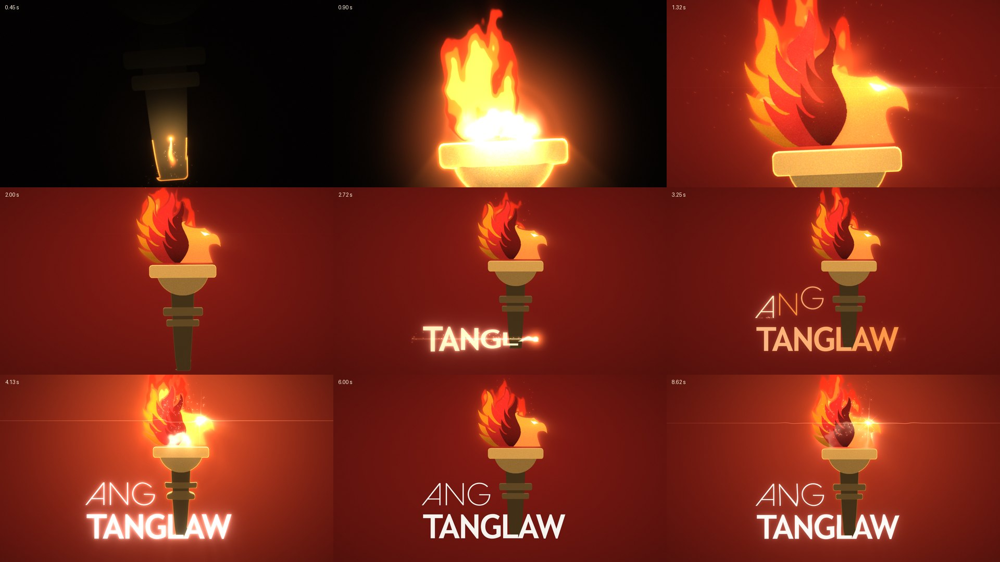

# Ang Tanglaw: logo reveal

A 9-second animated reveal of the Ang Tanglaw logo: aggressive, determined and confident. **Tanglaw**
means a light that shows the way, so the logo is forged by its own fire.

| File | What it is |
| --- | --- |
| `export/ang-tanglaw.mp4` | The reveal with sound (1920×1080, 60 fps, 9 s) |
| `export/ang-tanglaw-silent.mp4` | The same picture without sound, for laying your own music under it |
| `export/ang-tanglaw.wav` | The sound on its own (48 kHz stereo) |



## What happens

| Time | Picture | Sound |
| --- | --- | --- |
| 0.15 s | A comet of fire tears up the dark torch; its edges glow like heated metal as it passes | A hit, then a rising, fizzing roar |
| 0.85 s | It slams into the cup: the phoenix flame erupts in tongues of fire, sparks and light rays, with a shockwave and a camera jolt; the frame floods maroon | A sub boom, a drum and a rush of air |
| 1.3 s | The phoenix opens its eye in a star-burst and a lens streak, and it keeps glowing | A metallic shing |
| 1.05 to 2.65 s | The camera pulls back hard to the whole burning torch | Taiko drums |
| 2.6 s | A blade of fire cuts across, and **TANGLAW** opens out of the cut in white-hot letters that cool to cream | A blade swish and a hit |
| 2.95 s | **ANG** slams down above it, letter by letter, throwing sparks | Three toms |
| 3.35 s | A sheen crosses the logo while the camera leans in | A riser and a drum roll |
| 4.1 s | **The lockup:** the logo slams into place, the flame flares, the eye blazes, the letters flash | A sub drop, a crash and a brassy D chord |
| 4.1 to 8.5 s | The logo holds, burning hard: live flames lick up off the feathers, embers rise, the flame spits sparks, the eye glints | The chord holds over the roaring fire |
| 8.55 s | One last flare and eye flash to end on | A final hit |

The logo itself is never redrawn: the lettering, colours and layout are your design, and the live
fire is kept a hair away from the phoenix's outline so its silhouette always reads.

## Using it

* **Canva, PowerPoint, Google Slides, Keynote:** upload the MP4 and stretch it to fill a 16:9 page.
* **Before a video or a stream:** put it first; it ends on the logo, on a hit.
* **Social media:** it uploads as it is (H.264, 60 fps). For a square or vertical post, place it on a
  maroon `#711610` background.

## How it was made

The Canva PDF holds the logo as one picture with a soft mask; it is split into the flame, the torch
and every letter of ANG and TANGLAW, which are then animated separately. Where the handle runs behind
the "LA" of TANGLAW, its hidden part is rebuilt from its two straight sides, so the torch is whole
before the name arrives. The fire spreads through the flame along the shape of its feathers,
measured from the spot where the comet lands; the live flames around it are drawn flat, in the
logo's own oranges and reds.

```sh
python3 tools/prep.py "Draw - Bridge.pdf"   # split the logo into layers (numpy, scipy, opencv, pillow)
python3 tools/audio.py export/ang-tanglaw.wav
python3 tools/render.py --frames frames/ --mp4 export/ang-tanglaw.mp4 --audio export/ang-tanglaw.wav \
    --silent export/ang-tanglaw-silent.mp4
python3 tools/render.py --stills 0.5,0.95,2.75,4.15 --out previews/   # or just a few frames
```

`prep.py` needs `pdfimages` (poppler) for a PDF, or re-runs from `assets/source.png` with no argument.
Every frame depends only on its time, so `render.py` draws them in parallel; the timing lives at the
top of `render.py`, and `audio.py` follows it.

| File | What it does |
| --- | --- |
| `tools/prep.py` | Pulls the logo out of the PDF and splits it into layers in `assets/` |
| `tools/render.py` | Draws every frame and encodes the MP4 |
| `tools/audio.py` | Synthesises the sound to the same timeline |
